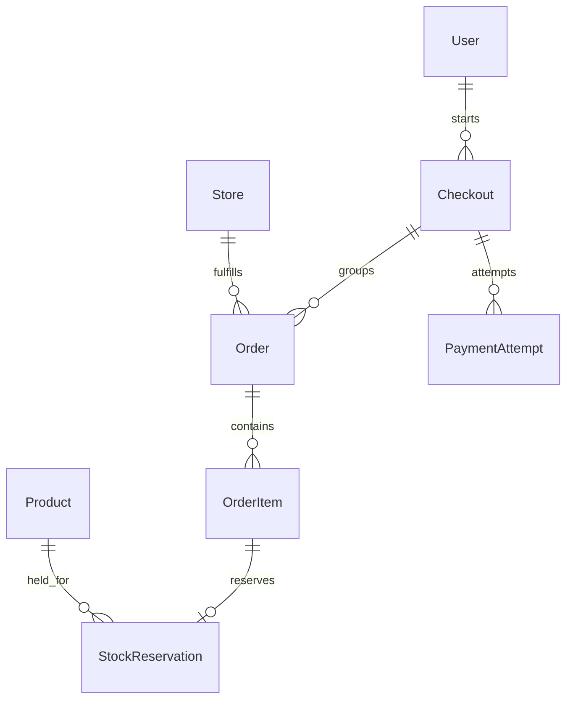

# Checkout: from review to store orders

Checkout turns the customer's selected products into saved purchases. A single
purchase can contain items from several stores. The backend creates one checkout
for the customer and one order for each store, so each store's delivery and
cancellation state can be tracked separately.

For example, buying a camera from one store and a case from another creates one
checkout containing two orders. Completing checkout does not mean either item
has been delivered.

## The normal flow

1. The frontend sends a direct product and quantity, or selected saved cart-item
   IDs, to the preview API.
2. The backend calculates current availability and prices. A valid review returns
   a signed preview token: a tamper-resistant record of the terms being reviewed.
   Preview creates no order and reserves no stock.
3. The customer selects a saved delivery recipient and payment method. The
   backend checks recipient ownership and saves copies of delivery details with
   the purchase.
4. Placement rechecks the reviewed terms and inventory. It saves one store order
   per store, with item names and prices copied into purchase records.
5. The result depends on the payment method below. The customer can read saved
   confirmation and order history afterward without placing another purchase.

An **idempotency key** identifies the original placement request. If a response is
lost, retry the same body and key. Generating a different key can create another
purchase. Reusing a key with different content is rejected.

## Cash on delivery and Stripe test payments

| Behavior         | Cash on delivery (COD)                        | Stripe test checkout                                              |
| ---------------- | --------------------------------------------- | ----------------------------------------------------------------- |
| Placement result | Completed checkout with unpaid store orders   | Pending checkout, payment attempt, and stock holds                |
| Physical stock   | Deducted at successful placement              | Deducted after verified payment                                   |
| Payment          | Remains unpaid; collection is not implemented | Hosted test card payment; no real money moves                     |
| Store ledger     | No entries                                    | Pending store credits posted atomically with payment finalization |
| Uncertain result | Retry exact placement body/key                | Recover the saved attempt and reconcile Stripe state              |

Stripe webhooks, explicit customer status checks, and scheduled recovery all use
verified provider state. A browser return URL is not payment confirmation. An
unresolved stock hold remains effective even after its local deadline until safe
provider resolution permits release.

The current Stripe flow uses one payment attempt and hosted session per checkout.
Retrying creation recovers that attempt; a closed attempt does not receive another
session. A new purchase requires a fresh review and key.

## Saved records

The core relationships below show which records belong together. The diagram is
a relationship overview; it omits fields and additional records such as provider
events, refunds, ledger entries, and order-history events.

Orders retain purchase snapshots, meaning copies of the recipient, names, prices,
and exchange rates accepted for that purchase. Later edits do not rewrite them.
Receipt images remain current catalog images rather than historical snapshots.
See [model structure and rules](../../architecture/checkout-models.md) for fields and safeguards.

## Prices and currencies

The source currency belongs to the store. COD preview resolves the customer's
personal-address currency, with USD fallback where the contract requires it.
Stripe test checkout uses USD. Conversion happens in pricing services, not model
`save()` methods. Failed required conversion blocks a checkout review; it must
never leave an original amount labelled as a different currency.

## Find the detailed contract

- [Saved recipients](recipients.md): address book, defaults, and ownership.
- [Preview](preview.md): selections, availability, currencies, and signed terms.
- [COD placement and confirmation](cash-on-delivery.md): atomic purchase and repeat requests.
- [Stripe test checkout](stripe.md): provider setup, holds, payment, and recovery.
- [Customer orders](../ecommerce/user-orders.md): cancellation, Stripe test refunds,
  and persistent history.
- [Demo wallet ledger](../../architecture/wallet-ledger.md): internal payment receipts and refund
  reversals; no customer wallet API or spending interface.
- [Development seed data](../../development/seed-data.md): repeatable sample purchases.
- [Frontend checkout](../../../../frontend/docs/checkout/README.md): customer screens
  and browser-side recovery.

Delivery operations, settlement release, returns, withdrawals, and COD payment
collection remain outside the implemented workflow. Customer cancellation refunds
are implemented and are distinct from a returns workflow.
