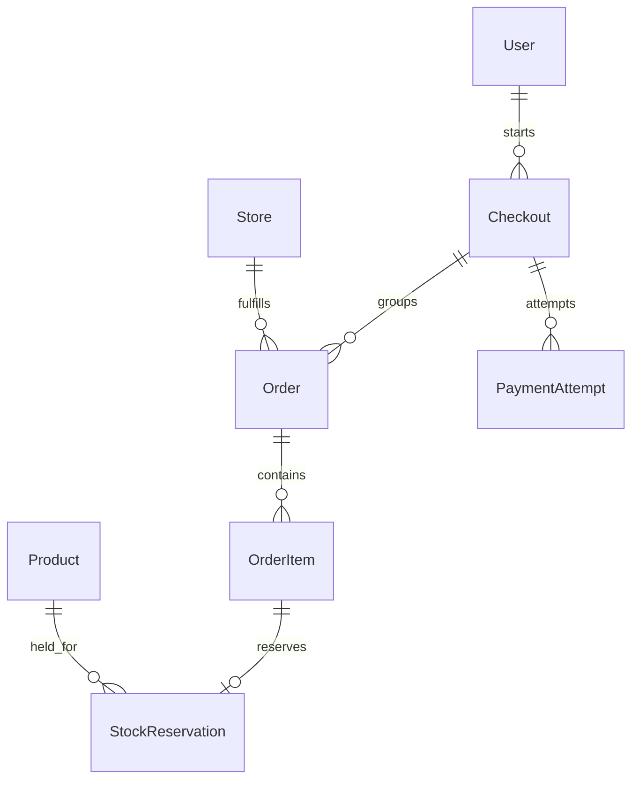

# Checkout model foundation

The checkout feature groups a customer's purchase into one order per store.
These models, their validation, development fixtures and inspection-only admin
are implemented, along with saved-recipient list/create and checkout preview APIs.
Placement, confirmation, stock locking during placement, Stripe integration, webhook
processing, reservation expiry and receipt pages are still future work.

- [Checkout preview API contract](preview-api.md)
- [Saved-recipient API contract](recipients-api.md)
- [Model structure and rules](models.md)
- [Development seed data](../seed.md)

Each checkout may contain many store orders but at most one order per store.
Retries create payment-attempt records for the same agreed checkout; they do not
create duplicate orders. COD orders need no Stripe payment attempt.

The source of pricing currency is the store's existing `currency` field. The
preview service resolves
the customer's currency and uses USD when it cannot be resolved or when required
conversion targets an unsupported currency. A failed FX lookup must not relabel
original store prices. No currency conversion or USD fallback is performed by
model `save()`.

## Code organization

Checkout business logic and snapshot helpers live in `apps/checkout/services/`.
Application code and the initial ecommerce migration import snapshot helpers
from `services.snapshots`. This is the only snapshot implementation.

Checkout tests live in `apps/checkout/tests/`. API-wide schema checks live in
`core/tests/test_openapi.py`, alongside seed tests in `core/tests/test_seed.py`.
