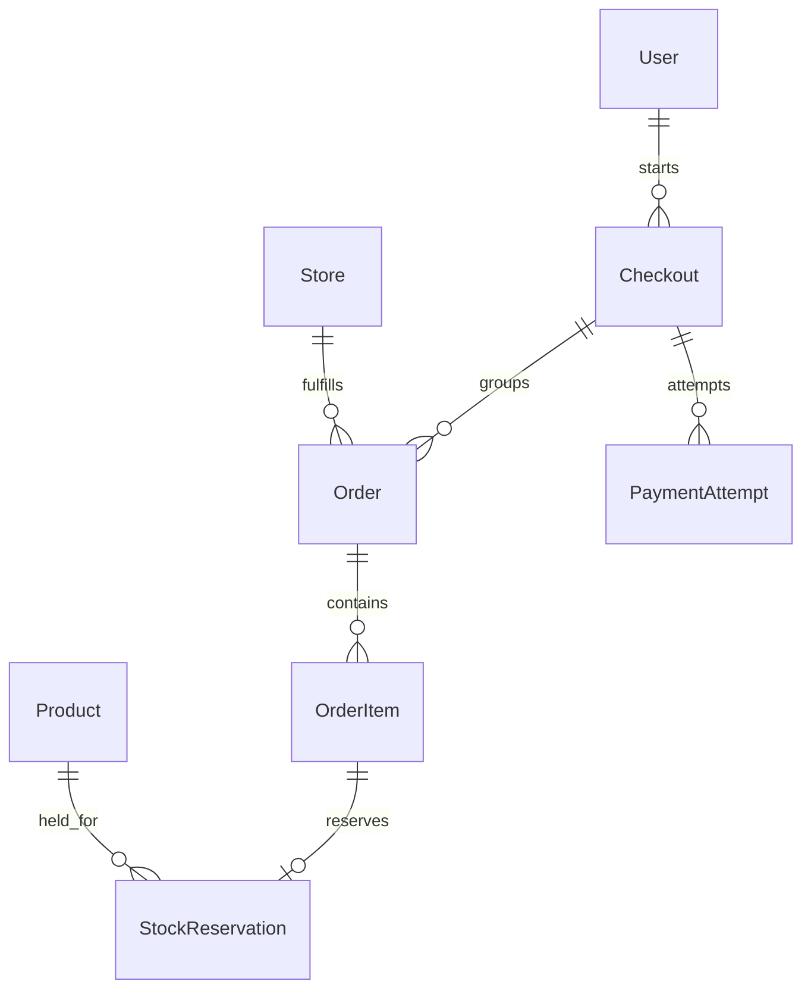

# Checkout model foundation

The checkout feature groups a customer's purchase into one order per store.
These models, their validation, development fixtures and inspection-only admin
are implemented. Checkout endpoints, stock locking, Stripe integration, webhook
processing, reservation expiry and receipt pages are still future work.

- [Model structure and rules](models.md)
- [Development reset and verification](development.md)
- [Development seed data](../seed.md)

Each checkout may contain many store orders but at most one order per store.
Retries create payment-attempt records for the same agreed checkout; they do not
create duplicate orders. COD orders need no Stripe payment attempt.

The source of pricing currency is the store's existing `currency` field. Resolve
the customer's currency in the future checkout service and use USD when that
currency cannot be resolved or is unsupported. A failed FX lookup must not relabel
original store prices. No currency conversion or USD fallback is performed by
model `save()`.
