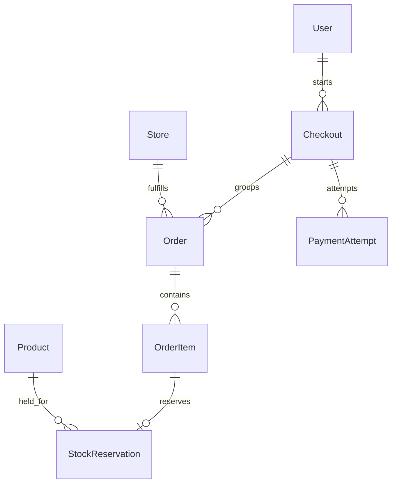

# Checkout feature

The checkout feature groups a customer's purchase into one order per store.
These models, their validation, development fixtures and inspection-only admin
are implemented, along with saved-recipient, checkout preview, atomic COD placement
and owner-only confirmation APIs. The frontend COD checkout and confirmation
pages are also implemented; see the [frontend handoff](../../../frontend/docs/checkout/README.md).
Stripe integration, webhook processing, reservation expiry, delivery and payment
collection workflows remain future work.

See the COD contract below.

- [COD placement and confirmation](cod-api.md)
- [Checkout preview API contract](preview-api.md)
- [Saved-recipient API contract](recipients-api.md)
- [Model structure and rules](models.md)
- [Demo USD wallet foundation](../wallet/README.md) — internal ledger only; not connected to checkout yet.
- [Development seed data](../seed.md)

Each checkout may contain many store orders but at most one order per store.
COD retries replay the existing purchase. Future Stripe retries can create payment
attempts for the same checkout; COD creates no payment-attempt records.

The source of pricing currency is the store's existing `currency` field. The
preview service resolves
the customer's currency and uses USD when it cannot be resolved or when required
conversion targets an unsupported currency. A failed FX lookup must not relabel
original store prices. No currency conversion or USD fallback is performed by
model `save()`.
